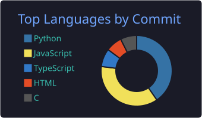
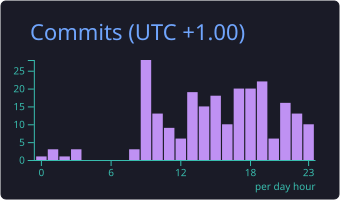

<div align="center">

🇫🇷 Français · <a href="./README.md">🇬🇧 English</a>


<a href="https://git.io/typing-svg"></a>

<br/>

[](https://stephane-talab.fr)
[](https://www.linkedin.com/in/stephane-talab-b89ba0349)
[](mailto:ProGen180@gmail.com)
[](https://visitorbadge.io)

</div>

> [!NOTE]
> Depuis le **1er novembre 2026**, je suis en alternance à la **DSI de la Région Hauts-de-France** comme apprenti responsable de projet, pendant mes deux années de Master MIAGE à l’UPJV (jusqu’en septembre 2028). J’y développe, intègre et maintiens des applications métier. Je reste ouvert aux petits projets freelance : [m’envoyer un mail](mailto:ProGen180@gmail.com).

---

## 👾 Qui je suis

```bash
$ whoami
stephane_talab

$ cat about.txt
Étudiant en M1 MIAGE à l’UPJV (Amiens), en alternance à la DSI de la
Région Hauts-de-France jusqu’en 2028 : apprenti responsable de projet.
Côté pro : applis Symfony, flux de données (ETL), et la gestion de
projet qui va avec, entre la maîtrise d’ouvrage et la maîtrise d’œuvre.
Freelance depuis 2022 : des sites et des applis web pour des
entreprises et des associations, du cahier des charges à la mise en ligne.
Le soir : CTF (crypto, web, reverse), IA et algorithmique des graphes.

$ cat now.txt
Je construis Jalon, une appli pour tenir mon journal d’alternance.
```

---

## 🛠 Stack

<div align="center">

**Frontend**<br/>


**Backend**<br/>


**Données et bases de données**<br/>


**IA et data science**<br/>


**Langages et scripts**<br/>


**Déploiement et outils**<br/>


**Sécurité**<br/>


</div>

---

## 🚧 En ce moment

| Projet | C’est quoi | Stack |
|--------|------------|-------|
| 🏛 Alternance | Apprenti responsable de projet à la DSI de la Région Hauts-de-France : développement, intégration et maintenance d’applis métier, transformation de données, suivi MOA/MOE | PHP · Symfony · ETL |
| 📓 Jalon | Mon journal d’alternance : une entrée par jour, des rapports prêts pour le tuteur, et des accès invités pour tuteurs et profs | PWA · Supabase · Netlify |
| 🏋️ Strevy | Étude de cas M1 MIAGE en équipe de 5 : une appli de suivi sport et nutrition, de l’analyse jusqu’au code | UML · Web |
| 🌐 Portfolio | Mon site, avec des études de cas et quelques démos : [stephane-talab.fr](https://stephane-talab.fr) | React · Next.js |
| 🛒 Applis clients | Les sites et applis que je développe et maintiens pour des entreprises et des associations | Next.js · Tailwind · PostgreSQL |
| 🔐 CTF lab | Mes scripts et write-ups de CTF | Python · Bash |

---

## 🏆 Parcours

- **2026 → 2028** · Apprenti responsable de projet, DSI de la Région Hauts-de-France
- **2026 → 2028** · Master MIAGE à l’UPJV, Amiens, en alternance (M1 en 2026–2027)
- **2026** · Stage au laboratoire LEFMI (UPJV) : jeu de confiance avec agents IA ([Trust_Game](https://github.com/ProGen18/Trust_Game)), enquête internationale en ligne ([wheel_survey](https://github.com/ProGen18/wheel_survey)), pipeline NLP sur des avis TripAdvisor ([TripAdvisor](https://github.com/ProGen18/TripAdvisor))
- **2026** · Mention honorable à la compétition de code de l’Université d’Artois, à l’ARC
- **2022 →** · Développeur fullstack freelance
- **2024 →** · CTF, surtout en crypto, web et reverse engineering
- **2022** · Stage en pentest : analyse de vulnérabilités, tests d’intrusion et les rapports qui vont avec

---

## 📊 Stats GitHub

<div align="center">
  
  
  <br/>
  
</div>

<div align="center">
  
  <br/>
  
  
</div>

### 🏅 Trophées

<div align="center">
  <a href="https://github.com/ryo-ma/github-profile-trophy"></a>
</div>

### 📌 Projets à la une

<div align="center">
  <a href="https://github.com/ProGen18/Trust_Game"></a>
  <a href="https://github.com/ProGen18/Snake_AI"></a>
  <a href="https://github.com/ProGen18/TripAdvisor"></a>
  <a href="https://github.com/ProGen18/wheel_survey"></a>
</div>

<div align="center">
  <picture>
    <source media="(prefers-color-scheme: dark)" srcset="./profile/snake-dark.svg"/>
    
  </picture>
</div>

---

## 📬 Contact

<div align="center">

Un projet freelance ou une question ? Écrivez-moi.

[](mailto:ProGen180@gmail.com)
[](https://www.linkedin.com/in/stephane-talab-b89ba0349)
[](https://stephane-talab.fr)

</div>

<div align="center">
  
</div>
