<div align="center">

<a href="./README.fr.md">🇫🇷 Français</a> · 🇬🇧 English


<a href="https://git.io/typing-svg"></a>

<br/>

[](https://stephane-talab.fr)
[](https://linkedin.com/in/ProGen18)
[](mailto:ProGen180@gmail.com)

</div>

> [!TIP]
> I'm looking for a work-study position (alternance) for my Master's in MIAGE. Fullstack is what I do every day; security and AI are what I'd like to do more of. I live in Amiens and can work anywhere in Hauts-de-France, or partly remote. [Send me an email](mailto:ProGen180@gmail.com).

---

## 👾 About me

```bash
$ whoami
stephane_talab

$ cat about.txt
M1 MIAGE student at UPJV, in Amiens.
I've been freelancing since 2022, mostly websites and web apps for
companies and associations. I usually handle the whole thing, from the
spec to the deploy.
In the evenings I play CTFs (crypto, web, reverse engineering).
Lately I've been reading a lot about AI and graph algorithms.
```

---

## 🛠 Stack

<div align="center">

**Frontend**<br/>


**Backend**<br/>


**Databases**<br/>


**Languages and scripting**<br/>


**Security**<br/>


</div>

---

## 🚧 Right now

| Project | What it is | Stack |
|---------|------------|-------|
| 🌐 Portfolio | My site, with case studies and a few live demos: [stephane-talab.fr](https://stephane-talab.fr) | React · Next.js |
| 🛒 Client apps | Web apps I build and maintain for companies and associations | Node.js · PostgreSQL · React |
| 🔐 CTF lab | Scripts and write-ups from the CTFs I play | Python · Bash |

---

## 🏆 Background

- M1 MIAGE at UPJV, Amiens (2026–2027)
- Freelance fullstack developer since 2022
- Honorable mention at the Université d'Artois coding competition, held at l'ARC (2026)
- CTFs since 2024, mostly crypto, web and reverse engineering
- Pentest internship in 2022: vulnerability analysis, intrusion tests, and the reports that go with them

---

## 📊 GitHub stats

<div align="center">
  
  
  <br/>
  
</div>

---

## 📬 Contact

<div align="center">

Got a work-study offer or a freelance project? Write to me.

[](mailto:ProGen180@gmail.com)
[](https://linkedin.com/in/ProGen18)
[](https://stephane-talab.fr)

</div>

<div align="center">
  
</div>
