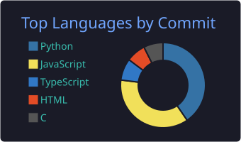
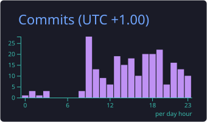

<div align="center">

<a href="./README.fr.md">🇫🇷 Français</a> · 🇬🇧 English


<a href="https://git.io/typing-svg"></a>

<br/>

[](https://stephane-talab.fr)
[](https://www.linkedin.com/in/stephane-talab-b89ba0349)
[](mailto:ProGen180@gmail.com)
[](https://visitorbadge.io)

</div>

> [!NOTE]
> Since **November 1st, 2026**, I've been a work-study apprentice project manager in the **IT department of the Hauts-de-France Region**, for the two years of my Master's in MIAGE at UPJV (until September 2028). I build, integrate and maintain business applications there. I'm still open to small freelance projects: [send me an email](mailto:ProGen180@gmail.com).

---

## 👾 About me

```bash
$ whoami
stephane_talab

$ cat about.txt
M1 MIAGE student at UPJV (Amiens), on a work-study contract with the
Hauts-de-France Region's IT department until 2028: apprentice project manager.
At work: Symfony apps, data pipelines (ETL), and the project management
that sits between business owners and the dev side.
Freelancing since 2022: websites and web apps for companies and
associations, from the spec to the deploy.
In the evenings: CTFs (crypto, web, reverse), AI and graph algorithms.

$ cat now.txt
Building Jalon, an app to keep my work-study log.
```

---

## 🛠 Stack

<div align="center">

**Frontend**<br/>


**Backend**<br/>


**Data and databases**<br/>


**AI and data science**<br/>


**Languages and scripting**<br/>


**Deploy and tooling**<br/>


**Security**<br/>


</div>

---

## 🚧 Right now

| Project | What it is | Stack |
|---------|------------|-------|
| 🏛 Work-study | Apprentice project manager in the Hauts-de-France Region's IT department: building, integrating and maintaining business apps, data transformation, business/dev coordination | PHP · Symfony · ETL |
| 📓 Jalon | My work-study log: one entry a day, reports ready for my tutor, and guest access for tutors and teachers | PWA · Supabase · Netlify |
| 🏋️ Strevy | M1 MIAGE case study in a team of 5: a sports and nutrition tracking app, from analysis to code | UML · Web |
| 🌐 Portfolio | My site, with case studies and a few live demos: [stephane-talab.fr](https://stephane-talab.fr) | React · Next.js |
| 🛒 Client apps | Websites and web apps I build and maintain for companies and associations | Next.js · Tailwind · PostgreSQL |
| 🔐 CTF lab | Scripts and write-ups from the CTFs I play | Python · Bash |

---

## 🏆 Background

- **2026 → 2028** · Apprentice project manager, Hauts-de-France Region IT department
- **2026 → 2028** · Master's in MIAGE at UPJV, Amiens, work-study (M1 in 2026–2027)
- **2026** · Internship at the LEFMI lab (UPJV): trust game with AI agents ([Trust_Game](https://github.com/ProGen18/Trust_Game)), international online survey ([wheel_survey](https://github.com/ProGen18/wheel_survey)), NLP pipeline on TripAdvisor reviews ([TripAdvisor](https://github.com/ProGen18/TripAdvisor))
- **2026** · Honorable mention at the Université d'Artois coding competition, held at l'ARC
- **2022 →** · Freelance fullstack developer
- **2024 →** · CTFs, mostly crypto, web and reverse engineering
- **2022** · Pentest internship: vulnerability analysis, intrusion tests, and the reports that go with them

---

## 📊 GitHub stats

<div align="center">
  
  
  <br/>
  
</div>

<div align="center">
  
  <br/>
  
  
</div>

### 🏅 Trophies

<div align="center">
  <a href="https://github.com/ryo-ma/github-profile-trophy"></a>
</div>

### 📌 Featured projects

<div align="center">
  <a href="https://github.com/ProGen18/Trust_Game"></a>
  <a href="https://github.com/ProGen18/Snake_AI"></a>
  <a href="https://github.com/ProGen18/TripAdvisor"></a>
  <a href="https://github.com/ProGen18/wheel_survey"></a>
</div>

<div align="center">
  <picture>
    <source media="(prefers-color-scheme: dark)" srcset="./profile/snake-dark.svg"/>
    
  </picture>
</div>

---

## 📬 Contact

<div align="center">

Got a freelance project or a question? Write to me.

[](mailto:ProGen180@gmail.com)
[](https://www.linkedin.com/in/stephane-talab-b89ba0349)
[](https://stephane-talab.fr)

</div>

<div align="center">
  
</div>
